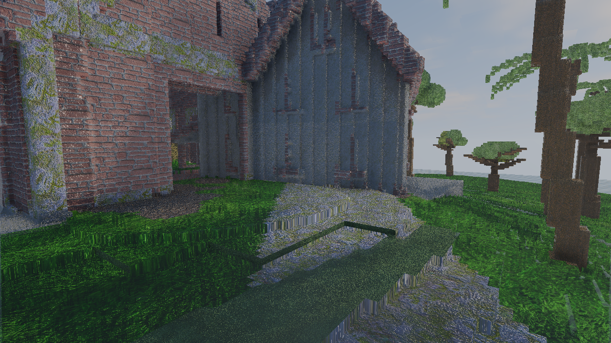
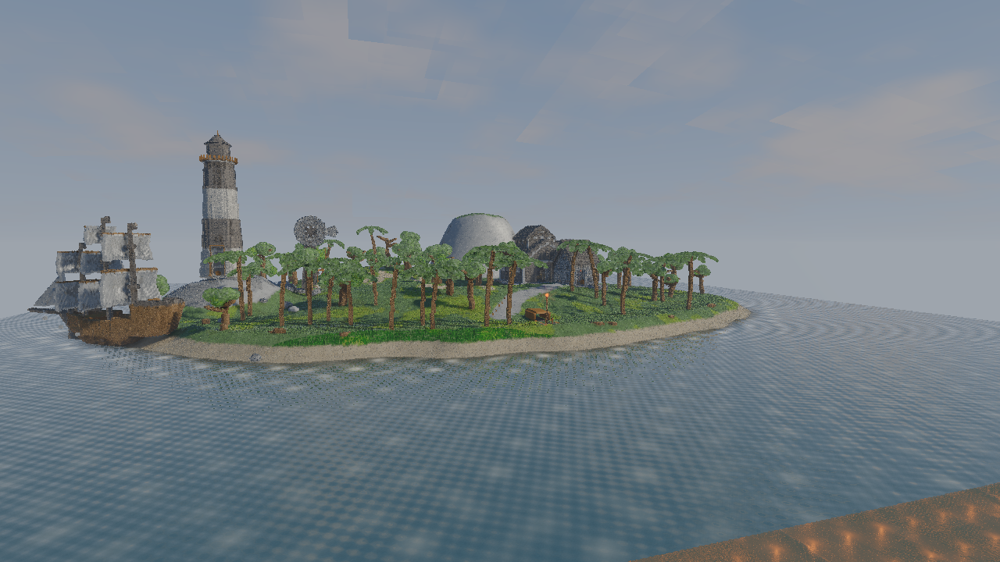

# Voxelforge

**Describe a 3D world in chat and watch it appear — no recompiling, no source edits.**

Voxelforge is a real-time 3D voxel world you can sculpt with a mouse or ask a
local AI to build through chat. Every piece of geometry lives in plain `.vxw`
files and hot-reloads while the app runs. Two render backends — Gaussian
surfels and an SVO reference — can be switched live with `F`.


*The editor in action — a detailed cottage, its own hearth glow, and the docked
sidebar. Everything on screen comes from `.vxw` records; nothing is baked into
the binary.*

## See it

| Night lighting, edited live | Sculpting after dark |
|---|---|
|  |  |

| Rustic cottage | The same cottage as raw voxels |
|---|---|
|  |  |

| LighthouseIsle scenery | Two render backends, one world |
|---|---|
|  |  |

*Same world, same camera — only the geometry backend differs; `F` toggles it
live. See the full [renderer comparison](docs/rendering-comparison.md) for
side-by-side views, pixel-level zooms and measured timings.*

## Highlights

- **Two render backends, one world** — Gaussian-surfel rasterization (default)
  for smooth, fast interactive views, plus a chunked SVO sphere tracer kept as
  the pixel reference. `F` switches between them.
- **Live editing** — a voxel brush (Carve / Add / Delete / Paint / Smooth /
  Rotate / Move) with undo and a persistent overlay. Stamps patch the running
  world in milliseconds.
- **AI builds geometry for you** — in-app chat or an MCP server. Ask for “a
  3×3 wood crate” and it appears, no recompile.
- **Lighting & night** — sun elevation drives day, dusk and night with a blue
  moon; authored lights plus lights derived from emissive materials.
- **Micro-voxel objects** — high-detail assets (e.g. a 5 mm alpaca) get their
  own fine lattice and composite over the world; derived skeletons animate
  grazers and a fur-card coat covers them.
- **Photo textures** — per-material PNG/JPG bindings in a 512² atlas with a
  GUI swapper.
- **Multiple sceneries** — self-contained world folders; switch in-session or
  from the command line.

## Quick start

Four commands from a fresh clone to a running world:

```sh
cmake -S . -B build -G Ninja
ninja -C build          # binaries + shaders
ninja -C build world    # bake assets — required once
./build/voxelforge
```

Requires Linux with a Vulkan 1.3 GPU, CMake ≥ 3.24, Ninja, a C++20 compiler,
`glslangValidator` and Python 3. All libraries are fetched automatically.
The asset bake is an explicit step — see
[Getting started](docs/getting-started.md) for requirements, build options and
the one-shot `start.sh` launcher.

## Controls

| input | action |
|---|---|
| `WASD` / `Q` `E` | move / fly down / up |
| `RMB` + mouse | look |
| wheel | scroll the sidebar |
| `Tab` | arm / disarm the edit brush (also opens the Edit section) |
| `+` / `-` (armed) | brush width ±1 voxel (`Shift` for depth) |
| `Shift+LMB` drag | define a bounding box to scope the brush |
| `X` | clear the bounding box |
| `Ctrl+LMB` | pick a voxel as the anchor for AI builds |
| `F` | cycle renderers: surfels → SVO → 3DGS |
| `B` / `G` / `H` / `J` | texture detail normals / SSR / SSAO / volumetric fog |
| `T` | cycle the AgX tonemap look |
| `Ctrl+B` | collapse the sidebar to the icon rail |
| `Ctrl+1..6` | jump to a sidebar section |
| window close button | quit (`Esc` is reserved and does not exit) |

Edit modes (Carve / Add / Delete / Paint / Smooth / Rotate / Move) are chosen
in the sidebar's Edit section — the letter keys are movement keys. Full control
reference, including the bounding-box and rotate/move gizmos:
[Getting started → Controls](docs/getting-started.md).

## AI editing

The **AI** section of the sidebar talks to any Ollama / OpenAI-compatible
server. Pick an anchor voxel with `Ctrl+LMB` and ask for *“a 3×3 wood crate”*,
*“a small rock”*… Edits land as `.vxw` changes and show up within ~0.5 s.
A stdio **MCP server** (`vf_mcp`) exposes the same operations to external
agents.

```sh
VF_LLM_URL=http://127.0.0.1:11434 VF_LLM_MODEL=qwen2.5 ./build/voxelforge
```

See [AI editing](docs/ai-editing.md) for the chat backend, tool normalization
and the MCP protocol reference.

## Documentation

Full developer documentation lives in **[`docs/`](docs/index.md)**:

| doc | contents |
|---|---|
| [`docs/getting-started.md`](docs/getting-started.md) | build, asset bake, controls, headless modes, troubleshooting |
| [`docs/architecture.md`](docs/architecture.md) | data flow, module tour, synthesis & hot-reload model |
| [`docs/world-format.md`](docs/world-format.md) | VXW binary spec, manifest schema, layer merge rules |
| [`docs/rendering.md`](docs/rendering.md) | GPU contract: handles, brick packing, push block, textures |
| [`docs/rendering-comparison.md`](docs/rendering-comparison.md) | surfels vs SVO side by side: screenshots, zooms, timings |
| [`docs/ai-editing.md`](docs/ai-editing.md) | chat backend, tool normalization, MCP protocol reference |
| [`docs/tooling.md`](docs/tooling.md) | full CLI / env reference, baker, `start.sh` |
| [`docs/testing.md`](docs/testing.md) | test gates, suite breakdown, debug workflows |
| [`docs/contributing.md`](docs/contributing.md) | invariants, conventions, gotchas, how-to recipes |

Engineering conventions for coding agents: [`AGENTS.md`](AGENTS.md).

