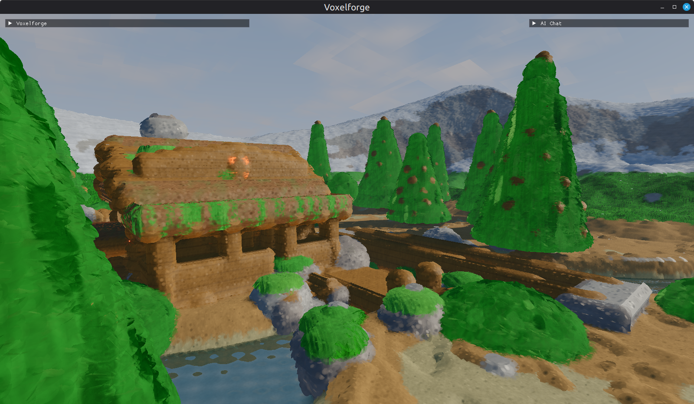
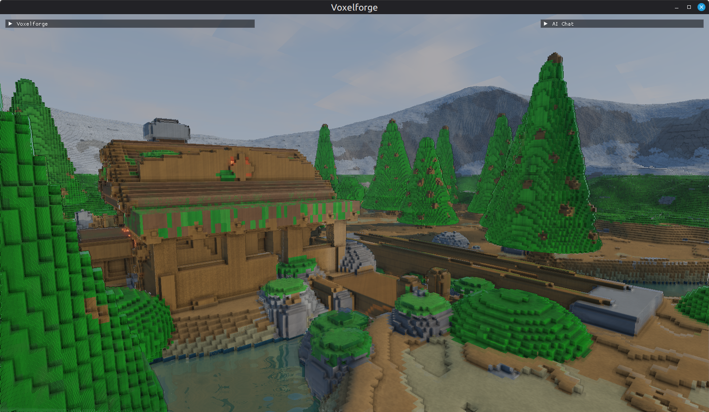
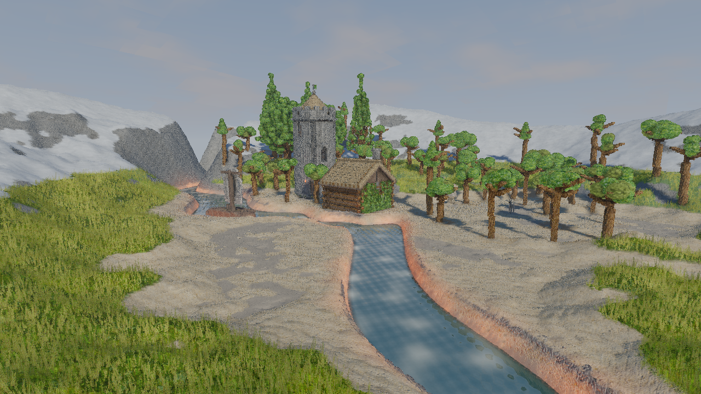
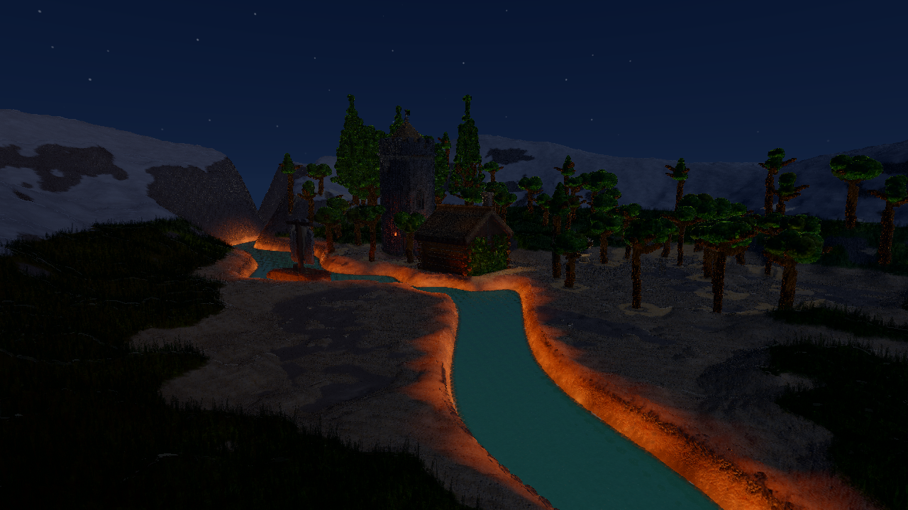
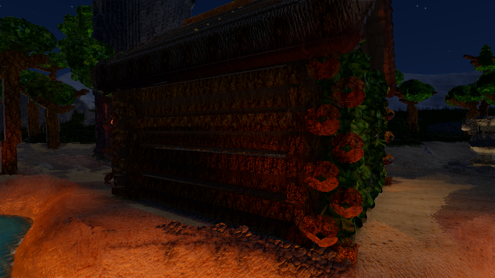
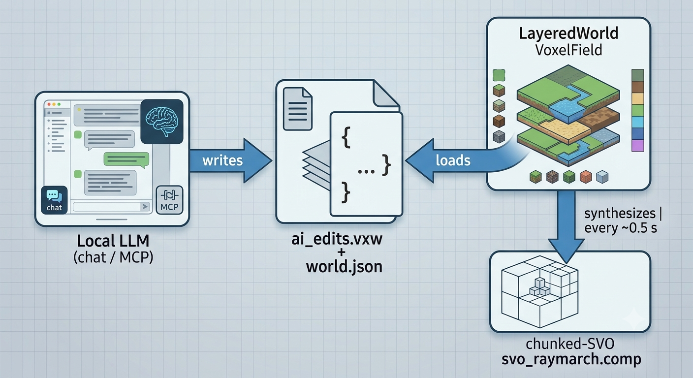

# Voxelforge

A real-time **dynamic voxel world** with two interchangeable render backends —
primary Gaussian-surfel rasterization and a chunked sparse-voxel octree (SVO)
sphere tracer kept as the pixel reference — where a local AI can add, remove
and shape voxel objects at runtime through chat or MCP tool calls, **without
ever touching source code**.

Every piece of geometry — rolling terrain, the lake, the hamlet's hall,
tower, pier, boat and props, anything the AI builds — lives in plain `.vxw`
voxel-record files. The renderer bakes those records into GPU octrees and surfels on the fly
and hot-reloads them while running.

| Gaussian surfels (`--mode splat`, default) | SVO raymarcher (`--mode svo`, reference) |
|---|---|
|  |  |

*Same world, same camera — only the geometry backend differs; `F` toggles it
live. See the full [renderer comparison](docs/rendering-comparison.md) for
side-by-side views, pixel-level zooms and measured timings.*

### Lighting and night

The renderer is time-of-day aware: the sun's elevation/azimuth drive day, dusk
and night, with a blue moon, authored + emissive-material-derived light
sources (up to a 256-light budget, 8 shaded per pixel) and an irradiance
volume for indirect bounce. Enclosed spaces (caves/rooms) keep their own
darkness via sky-visibility occlusion. Drag the sun in the **Render** section
of the sidebar, or pass `--sun ELEV AZIM`.

| Day | Night (moon + authored/derived lights) |
|---|---|
|  |  |

*Cabin close-up at night — emissive materials (hearth, lanterns) read as real
light sources and lift the interior:*



## Features

- **Gaussian-surfel rendering (primary backend, `--mode splat`, default)**: the
  CPU bake (`src/voxel/surfelize.*`) extracts one 80 B 2D Gaussian disk per
  outer surface cell — position, normal, baked sun shadow, bent-normal AO,
  material — plus deterministic micro-detail children that turn texture texels
  into real geometry. Instanced quads rasterize through a depth prepass +
  opaque base + Gaussian band, so surfaces stay watertight while silhouettes
  are soft and anti-aliased; frustum culling, GPU compaction, a Hi-Z occlusion
  pyramid and baked terrain LOD rings keep object-heavy and close-up views
  fast (`[`/`]` tunes disk size live). Same shading model as the reference —
  see the [renderer comparison](docs/rendering-comparison.md).
- **SVO raymarcher (pixel reference, `--mode svo`)**: chunked sparse-voxel
  octree sphere tracing (16³ chunks, 8³ bricks, 2 × uint32 per voxel:
  RGB + SDF, alpha/refl/rough/material) with exact per-pixel shadows and AO.
  Used to validate shading and A/B every change; `F` toggles backends live.
- **Records-only geometry** (`src/voxel/voxel_field.*`): terrain comes from
  per-column landscape records, objects from connected components flood-filled
  to solid volumes with a signed distance transform. No analytic scene code in
  the runtime or the shader.
- **Physically-flavoured shading**: ACES tonemapping, PBR-style specular,
  soft shadows from the smooth terrain heightfield + a coarse object-only SDF
  volume (so AI-placed objects cast correct shadows), bent-normal AO,
  Preetham-style sky, altitude fog, animated water with refraction/foam and
  underwater volumetrics, wind-sheared grass and foliage micro-geometry.
- **TAA** in interactive mode.
- **Live world editing**: layer toggles, MCP appends and chat edits land as
  `.vxw` file changes; the app polls mtimes and swaps freshly synthesized SVO
  buffers in-place (~0.5 s). Chat edits trigger the reload immediately. A
  docked sidebar (Edit / World / Render / Textures / Mesh / AI) arms a
  voxel brush (Carve / Add / Delete / Paint / Smooth / Rotate / Move) with
  undo and a persistent live-edit overlay.
- **Lighting & night**: sun elevation/azimuth drive day/dusk/night with a
  blue moon; authored lights plus lights derived from emissive materials
  (palette 9-15 and `"emissive"` texture bindings), an irradiance volume
  for indirect bounce, and enclosed-space sky occlusion so caves stay dark.
  Up to a 256-light budget, 8 shaded per pixel.
- **Micro-voxel objects**: high-detail assets (e.g. a 5 mm alpaca) get
  their own fine lattice + SVO overlay pass and composite over the world
  distance-wise; they cast/receive shadows via coarse representations.
  Derived skeletons animate grazers; fur is a translucent hair-card layer.
- **Photo textures**: per-material PNG/JPG bindings in a 512² atlas, triplanar
  world-space sampling, per-cell overrides, and a GUI texture swapper.
- **Sceneries**: self-contained world folders under `scenery/<name>/`; switch
  in-session from the sidebar or `--scenery`/`VF_SCENERY`.
- **AI tooling**: in-app chat window plus a stdio **MCP server**
  (`vf_mcp`) exposing `add_box / add_cylinder / add_ellipsoid / add_stamp /
  list_layers / enable_layer / probe / ground / clear_edits`.
- **STL/OBJ authoring in the GUI**: sidebar → **Mesh** section → **Import STL /
  OBJ** scans `assets/models/`, voxelizes a selected mesh onto the 10 cm
  lattice, and writes a named `.vxw` layer. Fit/scale, source-axis/winding,
  material, solid/shell, and anchor controls are exposed; replacing a placed
  layer preserves its manifest pose/orientation.
- **Authoring tools**: `vf_slice` prints ASCII cross-sections of the baked
  field (including AI edits); `--probe` answers point queries.

## Requirements

- Linux, Vulkan 1.3 (dedicated GPU recommended)
- CMake ≥ 3.24, Ninja, a C++20 compiler, Python 3 (for tests)
- `glslangValidator`
- An OpenAI-compatible endpoint or Ollama for the chat backend (optional)

All libraries (spdlog, GLFW, glm, VMA, doctest, ImGui) are fetched automatically.

## Build & first run

```sh
cmake -S . -B build -G Ninja
ninja -C build          # binaries + shaders
ninja -C build world    # bake heightmap + .vxw layers + world.json (once)
./build/voxelforge
```

The app refuses to start without baked assets — `ninja -C build world` runs the
offline baker (`tools/heightmap_gen.cpp`), which writes:

| asset | role |
|---|---|
| `scenery/LakesideHamlet/heightmap.png` | baker-side terrain source (2048², 5 cm/texel) |
| `scenery/LakesideHamlet/landscape.vxw` | terrain shell records (per lattice column) |
| `scenery/LakesideHamlet/hamlet_*.vxw` | runtime-authored object layers (hall, imported cabin, tower, pier, boat, well, market, garden, pines, props) written by `vf_mcp` or the GUI mesh importer |
| `scenery/LakesideHamlet/world.json` | layer manifest — order = dedupe priority, first wins a cell |
| `scenery/LakesideHamlet/ai_edits.vxw` | highest-priority live layer for chat/MCP edits |

A **scenery** is a self-contained world folder under `scenery/<name>/`; the
baker writes the shipped default (`LakesideHamlet`). `assets/` holds only the
shared library (`textures/`, `models/`) that every scenery draws on. Select a
scenery with `--scenery NAME` (one launch) or `VF_SCENERY`; the last-used one
is the default (see [docs](docs/sceneries.md)).

The app starts in the **lakeside hamlet**: `landscape` + the `hamlet_*`
object layers (plus your AI edits) are loaded. The "World layers" panel in-app
lists every `.vxw` file as a checkbox — tick `hamlet_tower.vxw`, … to load it
into the running world; untick to remove it. New files dropped into the
scenery folder appear after a rescan.

Layers store absolute world coordinates, so a checkbox materializes the object
exactly where it was baked. To place a copy somewhere else, pick an anchor with
`Ctrl+LMB` and hit the layer's **Import** button — it stamps the object at the
selection (bottom-center) by appending translated records to `ai_edits.vxw`,
leaving the original layer untouched. For triangle assets, use **Import STL /
OBJ** in the same panel; the current `hamlet_cabin` is reimported from
`assets/models/Forrest_Hunting_Cabin.stl` without changing its authored
`world.json` orientation.

## Controls

| input | action |
|---|---|
| `WASD` / `Q` `E` | move / fly up/down |
| `RMB` + mouse | look |
| wheel | scroll the sidebar |
| `Shift` / `Ctrl` | fly 3.5x faster / 4x slower (base speed: Render panel → View → Speed) |
| `Tab` | arm/disarm the edit brush (also switches sidebar to Edit) |
| `C` / `A` / `D` / `S` / `M` | Carve / Add / Delete / Smooth / Move mode (while armed) |
| `+` / `-` | brush width ±1 voxel (`Shift` for depth) |
| `Ctrl+LMB` | pick a voxel → anchor for AI builds / brush |
| `Shift+LMB` drag | define a bounding box to scope the brush |
| `X` | clear the bounding box |
| `F` | toggle splat / SVO renderer |
| `B` / `G` / `H` / `J` | texture detail normals / SSR / SSAO / volumetric fog |
| `Ctrl+B` | collapse sidebar to the icon rail |
| `Ctrl+1..6` | jump to a sidebar section |
| window close button | quit (`Esc` is reserved and does not exit) |

## AI editing

### In-app chat
The **AI** section of the sidebar talks to any Ollama/OpenAI-compatible
server. Pick an anchor voxel with Ctrl+LMB and ask for *"a 3×3 wood crate"*,
*"a small rock"*, *"a stamp shaped like an arch"*… The model's tool calls are
normalized (fuzzy names, inline JSON, escaped args), executed against
`EditableWorld`, and the world reloads instantly.

```sh
VF_LLM_URL=http://127.0.0.1:11434 VF_LLM_MODEL=qwen2.5 ./build/voxelforge
VF_LLM_URL=http://localhost:8080/v1 ./build/voxelforge   # llama.cpp / vLLM …
```

### MCP server
Register once (already wired for opencode in `.opencode/opencode.json`):

```json
{ "command": "./build/vf_mcp", "args": [] }
```

| tool | effect |
|---|---|
| `ground {x,z}` | terrain height + suggested anchor cell |
| `probe {x,y,z}` | signed distance + material at a point |
| `add_box / add_cylinder / add_ellipsoid / add_stamp` | append records to `ai_edits.vxw` (anchored at `"anchor":[x,y,z]` or `"ground":[x,z]`) |
| `list_layers` / `enable_layer` | inspect/toggle manifest layers |
| `clear_edits` | wipe `ai_edits.vxw` |
| `import_mesh` | convert an STL/OBJ into a named `.vxw` layer (GUI, CLI, and MCP share the pipeline) |

Edits are visible to a running instance within ~0.5 s — no repack, no rebuild.

## Command line

```
--selftest              headless acceptance check (sky probe + coverage)
--smoke N               run N frames headless, report timings
--shot out.ppm          render one frame and exit
--cam X Y Z TX TY TZ    camera placement
--sun ELEV AZIM         sun direction (degrees); elevation drives day/dusk/night
--animtime S            deterministic water/grass animation clock
--probe X Y Z           print field distance/material at a point, exit
--scenery NAME          select a scenery for this launch (no pointer write)
--mode splat|svo        render backend (default splat)
--width/--height        offscreen resolution for headless modes
--llm-url/--llm-model   chat backend override
```

## Testing

Tests are organized into focused, opt-in groups. Build once, then run only the
group that covers the change; do not run a bare all-tests command.

```sh
ninja -C build
ninja -C build test-surfel       # surfelize / surfel geometry
ninja -C build test-live-edit    # ChunkStore and live patches
ninja -C build test-visual       # camera / shader / scene acceptance
ninja -C build test-store        # store foundations and rebuilds
ninja -C build test-world        # layered world / SVO / records
ninja -C build test-smoke        # quick cross-area check; test-fast alias
```

Additional groups: `test-unit`, `test-effects`, `test-textures`, and
`test-fog`. CTest entries are group-gated; a bare `ctest --test-dir build`
skips them and there is no all-tests target.

Unit tests cover the authoring primitives, stamp semantics, VXW round-trip and
corruption handling, camera math, chat-tool normalization, and cross-check the
baked `VoxelField` against the analytic authoring truth. `visual_check` renders
the hero/house/water shots and asserts coverage, silhouette and sky probes.

## Architecture map

```
src/
  voxel/voxel_field.{hpp,cpp}   records-derived geometry oracle (terrain, EDT
                                object grids, sparse object SDF, shadow volume)
  voxel/layered_world.{hpp,cpp} manifest load/poll, priority merge, SVO synthesis
  voxel/chunk_store.{hpp,cpp}   runtime sparse voxel store (live edits)
  voxel/live_editor.{hpp,cpp}    instant-feedback brush driver
  voxel/editable_world.{hpp,cpp} ai_edits.vxw writer (box/cylinder/ellipsoid/stamp)
  voxel/micro_field.*            fine lattice for micro-voxel objects
  voxel/micro_svo.*              micro object SVO + overlay pass
  voxel/fur_cards.{hpp,cpp}      translucent hair-card coat generation
  voxel/worldfile.{hpp,cpp}     VXW v1 container (64 B header + CRC32)
  voxel/common.hpp              constants, palette, BAKER-side analytic shapes
  ai/ollama_client.cpp          HTTP chat client + tool-call parsing
  ai/mcp_server.cpp             vf_mcp stdio JSON-RPC server
  app/                          Vulkan app: sidebar UI, frame loop, picking,
                                world/edit/mesh/texture subsystems
  render/splat_pass.*           Gaussian-surfel raster backend (primary)
  render/svo_pass.*             SVO reference compute pipeline
  render/fur_pass.*             translucent fur-card raster pass
  render/taa_pass.*             temporal anti-aliasing resolve
  rhi/*                         context, buffers/images, swapchain
tools/heightmap_gen.cpp         offline asset baker (terrain shell)
tools/scene_slice.cpp           ASCII cross-sections of the baked field
```



Shader truth lives in `shaders/svo_raymarch.comp`: terrain is sampled from a
records-derived `rg32f` height texture (top Y + material), objects from bricks;
shadow rays march the smooth heightfield plus a coarse object-SDF volume.
There are no analytic scene constants in GLSL by design — new geometry only
ever arrives as data.

## Documentation

Full developer documentation lives in **[`docs/`](docs/index.md)**:

| doc | contents |
|---|---|
| [`docs/getting-started.md`](docs/getting-started.md) | build, asset bake, controls, headless modes, troubleshooting |
| [`docs/architecture.md`](docs/architecture.md) | data flow, module tour, synthesis & hot-reload model |
| [`docs/world-format.md`](docs/world-format.md) | VXW v1 binary spec, manifest schema, layer merge rules |
| [`docs/rendering.md`](docs/rendering.md) | GPU contract: handles, brick packing, push block, textures |
| [`docs/rendering-comparison.md`](docs/rendering-comparison.md) | surfels vs SVO side by side: screenshots, zooms, timings |
| [`docs/ai-editing.md`](docs/ai-editing.md) | chat backend, tool normalization, MCP protocol reference |
| [`docs/tooling.md`](docs/tooling.md) | full CLI/env reference, `vf_slice`, baker, `start.sh` |
| [`docs/testing.md`](docs/testing.md) | test gates, suite breakdown, debug workflows |
| [`docs/contributing.md`](docs/contributing.md) | invariants, conventions, gotchas, how-to recipes |

Historical design docs (records-only rework plan, roadmap, session log) live
in [`docs/history/`](docs/history/). Engineering conventions for coding
agents: [`AGENTS.md`](AGENTS.md).
