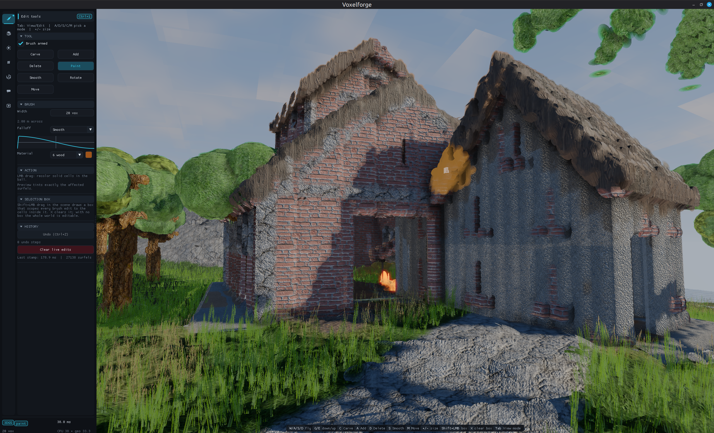
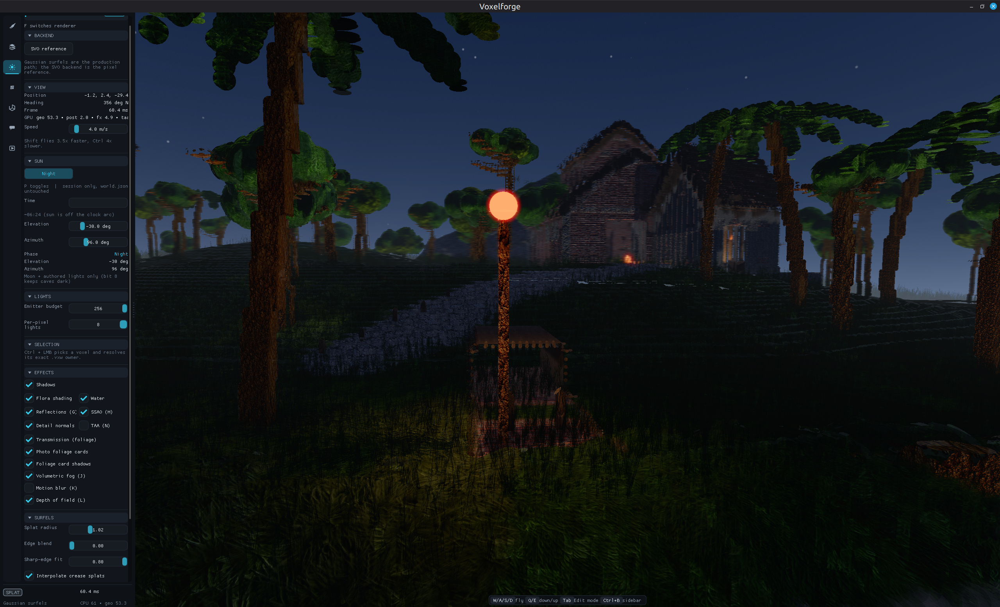
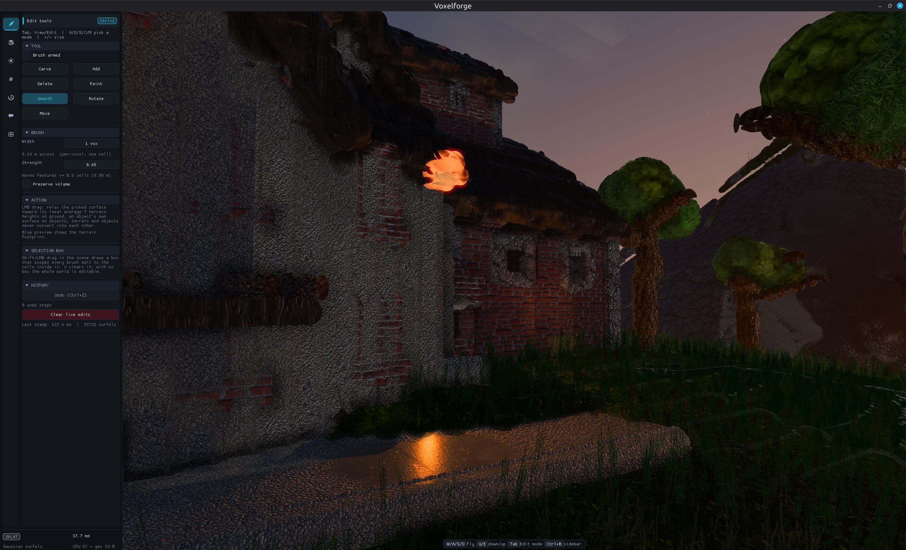
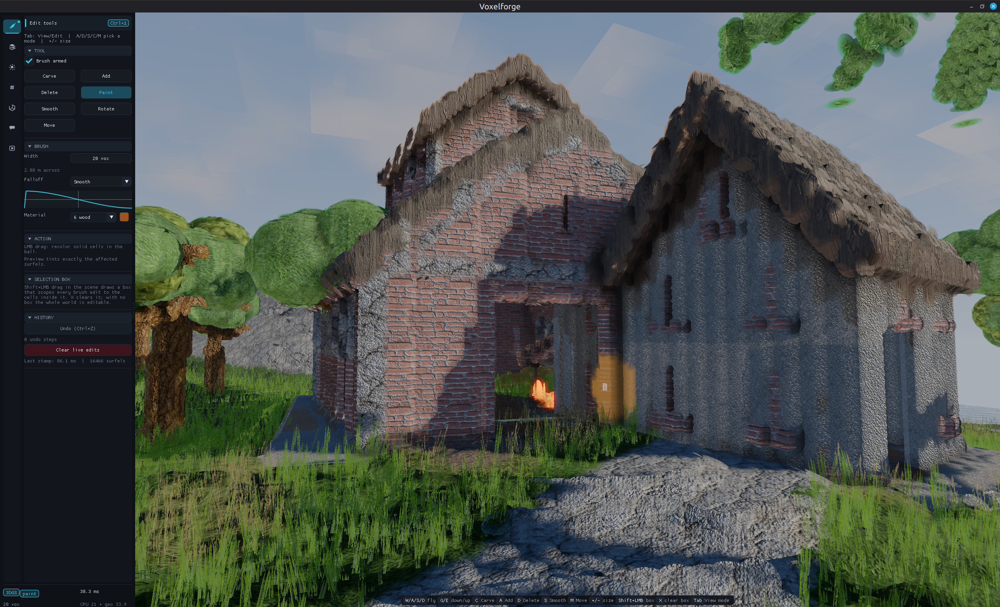
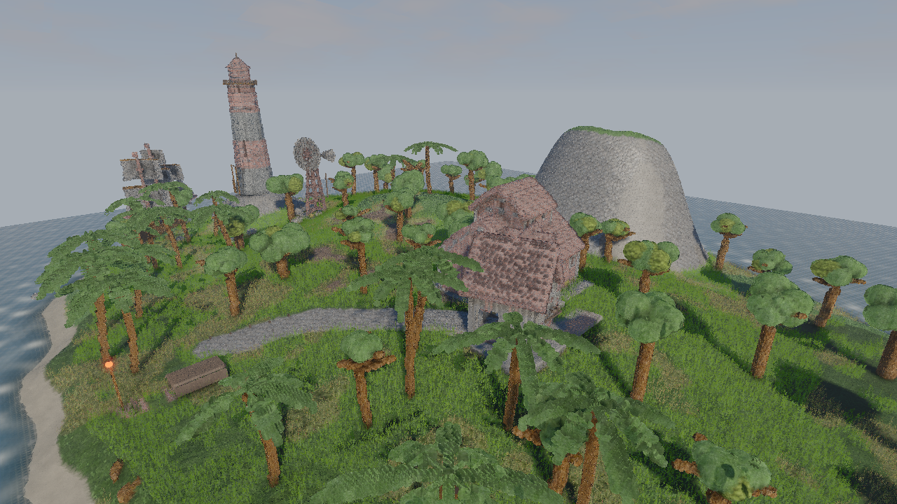

# Voxelforge

A real-time voxel world you can fly around, sculpt by hand, or have a local
AI build for you — without touching source code. Everything is data: terrain,
objects, and anything the AI places live in `.vxw` files that hot-reload while
the program runs.

Two renderers ship side by side. The default is a Gaussian-surfel rasterizer
(smooth, fast, the one you'll actually look at); the other is a chunked SVO
sphere tracer kept as the pixel reference. Press `F` to flip between them on
the exact same world.



*The editor in action. The docked sidebar on the left is the whole UI — Edit,
World, Render, Textures, Mesh, AI. Pick a voxel with Ctrl+LMB, ask the chat
for a crate, watch it appear.*

## Screenshots

| Night lighting, edited live | Sculpting after dark |
|---|---|
|  |  |

| A cottage | The same cottage as raw voxels |
|---|---|
|  |  |

| LighthouseIsle scenery | Surfels vs. voxels |
|---|---|
|  |  |

*Same world, same camera in the last pair — only the geometry backend differs.
See [renderer comparison](docs/rendering-comparison.md) for zooms and timings.*

## Building

```sh
cmake -S . -B build -G Ninja
ninja -C build          # binaries + shaders
ninja -C build world    # bake assets — required once
./build/voxelforge
```

You need Linux with a Vulkan 1.3 GPU, CMake ≥ 3.24, Ninja, a C++20 compiler,
`glslangValidator` and Python 3. Libraries are fetched by CMake, so there is
nothing to install by hand. The asset bake is a separate step on purpose — see
[Getting started](docs/getting-started.md) for requirements, build options and
the one-shot `start.sh` launcher.

## Controls

| input | action |
|---|---|
| `WASD` / `Q` `E` | move / fly down / up |
| `RMB` + mouse | look |
| wheel | scroll the sidebar |
| `Tab` | arm / disarm the edit brush (also opens the Edit section) |
| `+` / `-` (armed) | brush width ±1 voxel (`Shift` for depth) |
| `Shift+LMB` drag | define a bounding box to scope the brush |
| `X` | clear the bounding box |
| `Ctrl+LMB` | pick a voxel as the anchor for AI builds |
| `F` | cycle renderers: surfels → SVO → 3DGS |
| `B` / `G` / `H` / `J` | texture detail normals / SSR / SSAO / volumetric fog |
| `T` | cycle the AgX tonemap look |
| `Ctrl+B` | collapse the sidebar to the icon rail |
| `Ctrl+1..6` | jump to a sidebar section |
| window close button | quit (`Esc` is reserved and does not exit) |

Edit modes (Carve, Add, Delete, Paint, Smooth, Rotate, Move) are chosen in the
sidebar's Edit section — the letter keys are movement keys, not shortcuts.
Full control reference, including the rotate/move gizmos:
[Getting started → Controls](docs/getting-started.md).

## Editing with AI

The **AI** section of the sidebar talks to any Ollama or OpenAI-compatible
server. Pick an anchor voxel with `Ctrl+LMB` and ask for "a 3×3 wood crate" or
"a small rock" — the tool calls land as `.vxw` changes and show up within
about half a second. A stdio MCP server (`vf_mcp`) exposes the same operations
to external agents.

```sh
VF_LLM_URL=http://127.0.0.1:11434 VF_LLM_MODEL=qwen2.5 ./build/voxelforge
```

See [AI editing](docs/ai-editing.md) for the chat backend, tool normalization
and the MCP protocol reference.

## Documentation

Full developer documentation lives in [`docs/`](docs/index.md):

| doc | contents |
|---|---|
| [`docs/getting-started.md`](docs/getting-started.md) | build, asset bake, controls, headless modes, troubleshooting |
| [`docs/architecture.md`](docs/architecture.md) | data flow, module tour, synthesis & hot-reload model |
| [`docs/world-format.md`](docs/world-format.md) | VXW binary spec, manifest schema, layer merge rules |
| [`docs/rendering.md`](docs/rendering.md) | GPU contract: handles, brick packing, push block, textures |
| [`docs/rendering-comparison.md`](docs/rendering-comparison.md) | surfels vs SVO side by side: screenshots, zooms, timings |
| [`docs/ai-editing.md`](docs/ai-editing.md) | chat backend, tool normalization, MCP protocol reference |
| [`docs/tooling.md`](docs/tooling.md) | full CLI / env reference, baker, `start.sh` |
| [`docs/testing.md`](docs/testing.md) | test gates, suite breakdown, debug workflows |
| [`docs/contributing.md`](docs/contributing.md) | invariants, conventions, gotchas, how-to recipes |

Engineering conventions for coding agents: [`AGENTS.md`](AGENTS.md).

